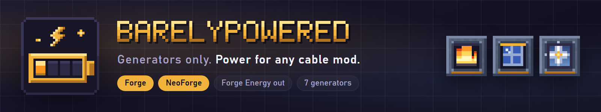

# BarelyPowered



Generators only. BarelyPowered adds seven ways to make Forge Energy (FE) and nothing else: no cables, no machines. Each generator pushes power into any block next to it that accepts FE, and any cable mod can pull it out.

| Generator | Power from |
|---|---|
| Hand crank | Right-clicks, free and tiny |
| Combustion generator (stone, iron, steel) | Coal, charcoal, logs, planks |
| Lava generator (stone, iron, steel) | Buckets of lava |
| Solar panel (tier 1, tier 2) | Daylight, sky access, weather; tier 2 keeps a trickle at night and in rain |
| Wind turbine (tier 1, tier 2) | Build height, open sky, storms; nearby blocks and other turbines reduce it |
| Water wheel | Flowing water beside or above it |
| Geothermal generator | Lava and magma next to it, steady, no fuel |

Right-click a generator with an empty hand to see its output, stored energy, fuel and why the output is what it is. Every rate, tier multiplier and weather, height and flow rule is in `config/barelypowered.properties`.

## Versions

One jar per Minecraft version, each holding both the Forge and the NeoForge layer.

| Minecraft | Loaders | Java |
|---|---|---|
| 1.21.1 | NeoForge, Forge | 21 |
| 26.1.2 | NeoForge, Forge | 25 |
| 26.2 | NeoForge, Forge | 25 |
| 26.3 | NeoForge, Forge | 25 |

Fabric is out of scope. Install: put the jar for your Minecraft version in `mods`. Needs nothing else; install it on the server and the clients.

## Documentation

The wiki is at https://itmecasey.com/wiki/barelypowered/ (generators, recipes, config, known gaps). The pages are kept in the website repository.

## What was verified

Honest status, per layer, is on the wiki's *Versions and known gaps* page and in `PROJECT_STATUS.md`. In short: every layer compiles and passes a headless server self test that places each generator beside an energy sink and checks the energy delivered; the scripted client tour (`scripts/client_tour.py`) shows each generator running. Balance has not been play-tested over a full game, and only AeroFlux energy pipes were tried among cable mods.

## Building

Each layer is its own Gradle build (`forge-<mc>`, `neoforge-<mc>`), compiling the shared `common/` (output math, config) and `version-<mc>/` (blocks, block entities) sources.

```
cd neoforge-1.21.1
./gradlew build
```

`scripts/build_all.sh` builds and tests every layer and combines the two loader jars of each Minecraft version into `dist/`. Resource files (textures, models, recipes, loot tables, language file) are generated by `python scripts/make_assets.py` (needs Pillow).

Checks that need no display: `python scripts/server_check.py all` (server load and generator self test on ports 8960 to 8967). With a display: `python scripts/client_tour.py neoforge-1.21.1` runs the screenshot tour.

## License

MIT. See [LICENSE](LICENSE).
