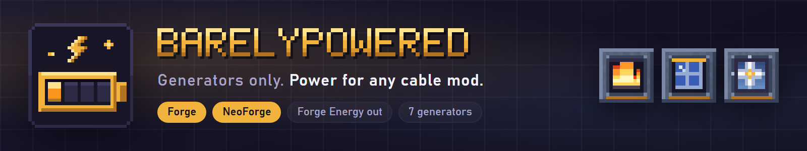
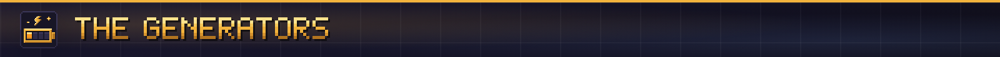
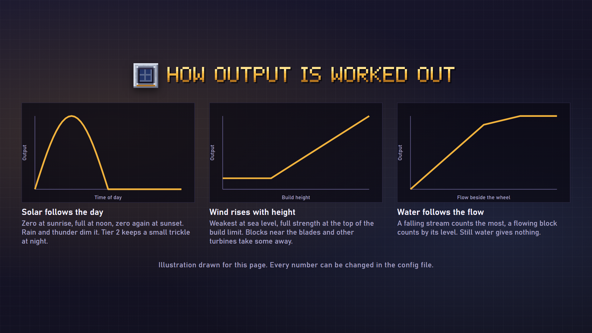
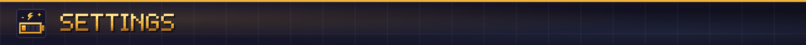
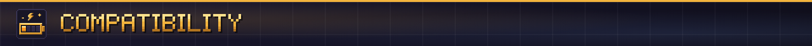
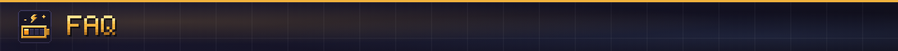

**Generators only. Seven ways to make Forge Energy, and any cable mod can carry it.**

BarelyPowered adds power sources and nothing else: no cables, no machines. Each generator pushes its energy into any block beside it that accepts Forge Energy, and cables from other mods can draw from it, so it slots into the pack you already have. Every source is tied to the world: the sun, the wind, a stream, a pool of lava.

- **Hand crank:** free and tiny. Right-click to turn it. Enough to start the first machine.
- **Combustion generator:** coal, charcoal, logs or planks. Stone, iron and steel tiers: hotter, faster, and more energy from each item.
- **Lava generator:** a bucket of lava, a lot of power. Three tiers.
- **Solar panel:** follows the day, needs open sky, dims in rain. Tier 2 keeps a small output at night and in storms.
- **Wind turbine:** output rises with build height. Open sky and clear blades matter, other turbines nearby steal wind, storms help. Two tiers.
- **Water wheel:** needs flowing water beside it or falling onto it. Output follows the flow.
- **Geothermal generator:** steady power from lava and magma touching it. No fuel.

Right-click any generator with an empty hand to see its output, the energy stored, the fuel left and why the output is what it is ("Low altitude, build higher", "Weather dims the sun").

Every output rate, tier multiplier and the weather, height and flow rules are in one file, `config/barelypowered.properties`. Recipes and the numbers behind them are on the wiki.

- Outputs plain Forge Energy through the loader's energy interface on Forge and NeoForge.
- Works against any block that accepts FE. A generator feeding AeroFlux energy pipes into a test block was checked on NeoForge 1.21.1.
- Optional plugin for Show Me What This Is is planned; nothing else is required.

The pictures on this page are illustrations drawn for the listing, not game screenshots.

**Tested:** every layer (Forge and NeoForge on 1.21.1, 26.1.2, 26.2 and 26.3) compiles and loads on a dedicated server, where a self test checks that each generator delivers the expected energy into a neighboring block. TESTED_CLIENT_TEXT Cable mods other than AeroFlux, hoppers and pipes feeding fuel, and recipe balance over a full game have not been tried yet.

**Does it need to be on the server?** Yes, on the server and on every client.

**Does it add cables or machines?** No. Use any cable mod and any machines.

**Can I change the numbers?** Yes, all of them, in the config file.

**Fabric?** Not at this time.

**Can I use it in my modpack?** Yes. It's MIT licensed.

Made by ItMeCasey Studios. Source and issues on [GitHub](https://github.com/ItMeCasey/BarelyPowered).
